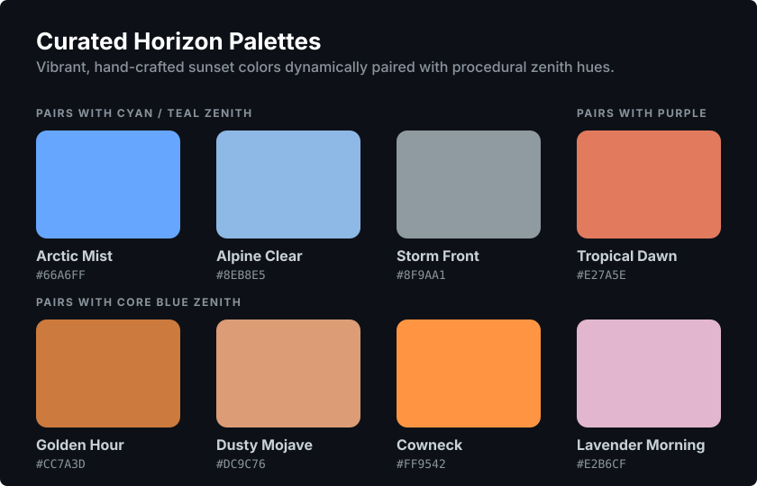

# Chill Flight

## Store metadata

<!-- Copy-ready metadata assets for store listings (Google Play Store, Apple App Store, and other distribution platforms). Storing these in version control ensures consistent description updates across platforms. -->

### Game title

<!-- Max 30 characters -->

Chill Flight

### Description

<!-- Max 4,000 characters -->

A minimalist flight simulator set in a vast, ever-changing world.

Drift along to lofi beats as you explore diverse landscapes featuring dynamic weather, day-night cycles, and biomes that shift with each journey.

Music by Purrple Cat.

Have a chill flight.

### Keywords

<!-- Max 100 characters -->

flight,simulator,chill,lofi,relaxing,procedural,exploration,ambient

## Music

In-game radio features tracks by Purrple Cat (Used with permission/attribution).

Music plays at half volume, about where background music usually sits in a game (the tracks are mastered at streaming loudness), and drops lower while paused (`MUSIC_VOLUME` in `audio.js`). iOS ignores web audio volume, so on iPhone and iPad it plays at full volume.

To start without sound (say, on a train), tap the speaker button under Start on the title screen. It turns off both music and sound effects, and the choice is saved: later visits skip the title screen and start silently. Either can be turned back on in settings.

## Sound effects

Procedural sound effects generated in real time with the Web Audio API provide ambient immersion without adding download weight.

- **Engine:** Synthesizes a warm piston propeller tone (sub-octave rumble, dual oscillators, an upper-mid rasp that carries on phone speakers, and propeller chop) pitched and getting louder with airspeed and throttle. While music is on, the engine plays 12 dB quieter (`ENGINE_MUSIC_DUCK` in `sfx.js`) so its drone sits under the music instead of competing with it. Twin-engine aircraft feature dual asynchronous props with acoustic beat frequencies; the glider replaces motor sounds with a soothing wind rush across the wings.
- **Ambiance:** When parked on land, tranquil environmental soundscapes fade in: meadow crickets at dusk and night, or a soft countryside breeze during the day. On water, small waves lap at the floats.
- **Events and places:** A thump on touchdown and a splash on water landings, tyre rumble while taxiing, spray hiss on the water, the landing gear's whir and clunk, wind rushing past when the plane falls, rain on the canopy, the falls' roar growing as you approach, typed dialog blips pitched per person, and a soft chime when a job step is done or a waypoint is reached. Each can be switched off on its own in the debug menu (and auditioned in the sound lab, `debug/debug-sound.html`).
- **Controls:** Sound effects can be toggled in the pause menu settings or temporarily via the `?sfx=0` / `?sfx=1` URL parameter. Sound effects automatically mute when paused and stop entirely while the game is in the background. With no saved choice they follow the music setting.

## Biomes

The world is organized around a central coordinate system (0,0) where latitude (Z) and longitude (X) determine the primary environmental shifts.

The land is a continent with sea on every side (`continentPast` in `chill-flight-logic.js`). Its outline is one of five hand-made shapes (`CONTINENTS`), which the world seed picks between, so each day's world may have a different one (about a fifth each); the `continent` URL parameter forces one. Each shape is a few overlapping, tilted ellipses for the main continent and one for the eastern land, blended where they meet and warped by smooth noise at the 1 to 3 degree scale, so the coasts lean, taper and hook rather than following the lines of latitude and longitude:

- **Leaning:** The body tilts from north-west to south-east, with a long peninsula running south-west and a cape in the north.
- **Taper:** Wide in the north, narrowing south to a point, like Africa or South America.
- **Crescent:** A western arm curves south and hooks round toward the east, sheltering a bay.
- **Lobes:** Two big lobes on a diagonal, a high north-west and a low south-east, joined at the waist.
- **Boot:** A long leg runs south-east from the west, ending in a toe and a heel at about 12 to 14 South, with a deep gulf inside it.

Every outline also keeps the island sea (`ISLAND_SEA`), and none touches the heartland: within 2.5 degrees of 1 West, 0 (X = -5000, Z = 0), which takes in spawn, the falls, the volcano and Meadow and Lagoon Fields, no coast shapes the land, and coasts fade in out to 4 degrees. The eastern land rises out of the island sea along a wandering line around 10 East (X = 50000), with a cape at 1.5 North and a bay at 4.5 South. The main continent's own east coast, around 0 longitude, wanders up to about 1.2 degrees east or west with latitude outside the heartland (`eastCoastShift`), so it doesn't run straight down a meridian.

Across the outline, a band 10000 units wide becomes rugged coast (`coastDetail`): coves and spits, broad bights and headlands, fjords cutting inland, island chains breaking off, and barrier islands with lagoons behind them. How broken the coast is varies along it, from smooth shores to stretches thick with fjords and islands. Past it lies open sea. The coast only cuts into the land, never raises it, so where the outline crosses the island sea, the sea stays open. The western alien land runs right out to the west coast. On the south coast, drowned land becomes a warm, shallow sandy shelf instead of deep sea, out to about 5000 units past the outline: turquoise water 2 to 4.5 units deep, reefs just under the surface and low sand cays (`southShelfFloor`).

| Biome             | Direction     | Latitude/Longitude          | Primary Characteristics                                                                                                             |
| :---------------- | :------------ | :-------------------------- | :---------------------------------------------------------------------------------------------------------------------------------- |
| **Temperate**     | Central       | Around (0, 0) (Center)      | Lush green plains and thick forests. High density of civilization (houses, barns, windmills).                                       |
| **Snowy**         | North         | Negative Z (North Latitude) | Frozen terrain, snow-capped mountains, icy water, pine forests, and light snow whenever cloud is overhead (never from a clear sky). |
| **Desert**        | South         | Positive Z (South Latitude) | Sandy dunes, reddish rock canyons, turquoise water, cactuses, and dead trees.                                                       |
| **Archipelago**   | East          | Positive X (East Longitude) | Coastlines flatten starting at 0.0 Longitude, leading to large island chains beyond 0.6 East (X > 3000).                            |
| **Lake District** | West          | Negative X (West Longitude) | Long lakes filling the valleys between hills and ranges, west of 0.7 West (X < -3500), within about 2 degrees of the equator.       |
| **Alien Zone**    | Far East/West | From about 10.0 East/West   | Warped, jagged alien topography with glowing neon seas and surreal colors.                                                          |

### 1. Temperate central (the heartland)

- **Location:** The area surrounding the equator (Z=0, 0.0 Latitude) and prime meridian (X=0, 0.0 Longitude).
- **Landscape:** A mix of rolling plains (#7CB342) and dense deciduous forests (#388E3C).
- **Key Features:**
  - **Structures:** Most common area for houses, barns, windmills, and monasteries. Houses have steep gabled roofs with overhanging eaves and vary in proportion (long farmhouses, narrow townhouses), and gather in villages and hamlets on flat ground, in short rows that share their village's orientation, with only a few lone farmhouses between them (`terrain-gen.js`). Now and then a highway runs through a denser village: a stretch of 350 to 800 units lined on both sides with houses facing the road, a second row behind them toward the middle, and gaps for lanes, thinning out at its ends. Each road is split into 6,000-unit stretches and about half hold one, built only where the roadside is dry and flat (`roadVillageHouses` in `terrain-gen.js`). Barns, windmills, monasteries and castle ruins also need fairly flat ground. Houses take regional styles: grey stone with slate roofs in the snowy north, and ochre adobe with flat roofs and no chimneys in the arid south.
  - **Plains and plateaus:** Between the mountains, a slow field tens of kilometers across gives the land broad character: open plains where the hills settle into gentle lowland, and plateaus, tablelands about 170 m higher behind steep escarpments. The rest is rolling hills, so long flights change character (`landformAt` in `chill-flight-logic.js`).
  - **Farmland:** Around the villages, gentle ground below the upland woods is a patchwork of strip fields in wheat, barley, young green crops, dark green rows and plowed earth, with some left as pasture. The land is split into parcels about 1,500 units across, each turned to its village's orientation, so neighboring parcels meet at an angle. Fields are cleared of the woods, and hedgerows of bushes and the odd tree run along most field edges (`fieldAt` and `hedgeNear` in `terrain-gen.js`).
  - **Trees in the wind:** Tree canopies sway gently in slow, uneven gusts, more in overcast weather, all leaning the same way downwind (`addWindSway` in `terrain-geometry.js`).
  - **Vegetation:** Oak-like deciduous trees and bushes.
  - **Water:** Standard sky-blue water (#40C4FF) often featuring lily pads and piers.

### Lake district (the west)

- **Location:** West of 0.7 West (X < -3500), fading in over 0.8 degrees, between about 1.8 North and 1.8 South (Z between -9000 and 9000, fading out by 2.6 degrees).
- **Landscape:** The valley floors are flooded, so lakes take the shape of the valleys: long lakes fingering between the hills and ranges, with the land around them easing down to gentle shores. How high the water reaches varies slowly across the region, so there are lake-filled districts and drier ones, different for each world seed. Rivers and the west coast highway run through (`VALLEY LAKES` in `getElevation`, `chill-flight-logic.js`).
- **Islands:** Some larger lakes have wooded islands, which rise at most to the height of the land around the lake.

### 2. The frozen north

- **Location:** Snow starts around Latitude 1.5 North (Z = -7500) and deepens gradually to full cover by 2.5 North (Z = -12500). Away from spawn's longitudes (more than 2.5 degrees either side of 1 West), the snow line wanders up to about a degree north or south in long curves (`snowWobble`), so it doesn't follow a line of latitude; near spawn it holds still, keeping the falls clear of the snow. The snowline on mountains comes down gradually from 1,150 units near the equator to 750 by 1.0 North, so the first northern range is green and rocky with snow-capped peaks, and then with the snow cover down to the valleys. Ground, water ice, trees and snowfall all use one snow cover function (`snowFactorAt` in `chill-flight-logic.js`). The sea past the north coast is frozen from around 4.0 North (Z < -20000), past a lane of open water along the shore whose width wanders from nothing (ice frozen to the shore, in among the islands) to about 9000 units (open bays), and a band of floes that grow larger and closer together over 12500 units until they join into solid pack (`seaIceAt`).
- **Landscape:** Permanent snow cover (#FFFFFF) even at lower altitudes. White-tinted forests (#8BA192). Past the north coast, the open water along it and a broken edge of floes, the ocean freezes over into a solid, jagged pack ice shelf (#A2B4BC) that rises out of the water. Lakes on the land stay open. In bright midday sun, snow and ice are dimmed slightly and shifted cool (`uSnowExposure`) so their shading stays visible instead of washing out to flat white.
- **Weather:** Light snow whenever there's cloud overhead, with occasional global breaks. Cloud builds sooner over the snow, so snowy weather is common, but it never snows from a clear sky.
- **Key Features:**
  - **Mountain ranges:** The first range north always rises around 1.0 North (Z = -5000), south of the snow, so it's green with snow-capped peaks; ranges further north vary by world seed and are snowbound. Ranges start at 0.5 West (X = -2500) and reach full height by 1.5 West (X = -7500), with sharp, ridged peaks up to 1600 units.
  - **The far north:** From about 3 North the low ground isn't all snow. The wind scours small patches of grey-green tundra, and tors (steep, lumpy knobs of dark rock 45 to 115 units high) break through in scattered districts, kept clear of the highway (`torAt` in `chill-flight-logic.js`); steep banks show bare rock too. North of about 4.4 North the land's lakes and rivers freeze over into a flat sheet of blue-white ice, with smooth, ragged edges where it meets open water; highway bridges still cross them.
  - **Objects:** Snowmen, chimney smoke from houses, and frost-covered pine trees.
  - **Water:** Icy, pale blue water (#88CCFF) that transitions into solid, textured cyan ice (#6CA6A8) shelves and floating icebergs in the deep north.

### 3. The arid south (Arizona style)

- **Location:** Latitude 1.5+ South (Z > 7500). Like the snow line, the desert's edge wanders up to about a degree north or south away from spawn's longitudes (`desertShift`).
- **Landscape:** Reddish-orange sand (#F4A460) and deep red canyon rock (#C24B2B).
- **Key Features:**
  - **Mountain ranges:** The first range south always rises around 1.0 South (Z = 5000), still green. Ranges further south vary by world seed; in the desert (beyond about 2.3 South, Z = 11500) they become broad mesas and rugged red-rock peaks.
  - **Desert lowland:** From about 2.2 South the low ground between the ranges is shaped by the desert (`desertLowlandAt` in `chill-flight-logic.js`). Dune fields cover most of it: long ridges up to about 44 units high and 400 apart, lying across a wind from the west-south-west, with gentle windward slopes and steep lee faces, and the hills beneath them flatten into a sand sea (`duneAt`). Lone mesas and buttes stand out on the flats, one in most 2.5 km cells: flat tops 190 to 330 units up with sheer walls over a talus skirt, some with a smaller butte on top, kept clear of the airfields, the canyon and the highway (`mesaAt`). Inland lakes dry to white salt pans just above the water; a lake reaching toward the coast keeps water at its seaward end.
  - **Vegetation:** Cactuses and skeletal "dead" trees.
  - **The canyon:** A Grand Canyon cuts the desert south of spawn's longitudes, at about 1 East (see Landmarks).
  - **Water:** Deep turquoise tropical-style water (#00CED1). The south coast is warm and shallow: a sandy turquoise shelf with reefs and sand cays (see Biomes above).

### 4. Coastal islands (the east)

- **Location:** Longitude 0.0+ East (X > 0), transitioning to full ocean and islands beyond 0.6 East (X > 3000). Outside the heartland the continent's east coast wanders up to about 1.2 degrees either side of 0 longitude.
- **Landscape:** The land flattens significantly into sandy beaches before transitioning into the deep ocean.
- **Key Features:**
  - **Islands:** Island chains generated by domain-warped noise, featuring jagged coastlines and sharp, rugged mountain peaks rising from the sea. From about 2.5 to 9.5 East a second field of clusters fills the gaps between the first, so the crossing to the alien land has islands along the way on every seed (`midSea` in `getElevation`).
  - **Vegetation:** Palm trees (#689F38) are found exclusively along these coasts.
  - **Maritime:** Sailboats.

### 5. The alien territory (the extremes)

- **Location:** The far extremes of the map, from about 10.0 East (X > 50000) or 10.0 West (X < -50000). Neither edge is straight: the eastern land rises out of the island sea along a wandering line with a cape and a bay (`eastLandLon`), and the western alien land begins along a line that wanders up to about 1.4 degrees either way (`westAlienEdge`); the alien colours follow the same edges (`alienAt`).
- **Landscape:** Highly distorted, jagged crystalline peaks and surreal terrain generation.
- **Key Features:**
  - **Terrain Warping:** The far East is a basalt honeycomb: hexagonal columns about 1000 units across, flat-topped and sheer-sided, each its own height (taller toward the middle of the land), with ravines between them that flood into channels on low ground. Whole columns are land or sea, so its swirling, domain-warped islands have stepped, hexagonal coasts (`basaltAt` in `chill-flight-logic.js`). The far West features massive geometric stepped plateaus, crystal spires and deep chasms.
  - **Props:** Ordinary trees, buildings and birds give way to alien ones (giant mushrooms in the East, clusters of glowing crystals in pink, orange and violet in the West) a little way in, where the alien terrain and colours have taken hold (`alienAt` above 0.3).
  - **Colors:** Normal biomes are completely overtaken by vibrant, neon hues (cyan in the East, magenta in the West) that wash over the landscape. In the West the colours take over twice as fast as the terrain changes and cover the snow and grass completely, with pale pink crystal spires, so the spires never stand on green fields or read as snowy peaks.
  - **Seas:** The water transforms into a bright glowing liquid that bleeds smoothly onto the alien shorelines.

> [!NOTE]
> **Water surface:** Water mirrors the sky with a Fresnel reflection (looking down you see the water, toward the horizon you see the sky's colors), and the sun lays a glitter path across it from the horizon toward the viewer, golden at low sun, with sparkles up close. At night the moon lays a silver path the same way, visible even for a thin crescent. Open water (about 10 units deep) is opaque deep blue; shallows around islands and shores turn turquoise. The water's depth is sampled per pixel from each chunk's terrain height grid (a small texture per water chunk), so shallows and foam follow the shore in smooth curves; color and transparency use that depth softened over about 200 units for a gradual blend, and the swell calms in shallow water. A band of foam lines every shore at the same width (its distance to shore is estimated from how quickly the depth changes), with rings that roll toward the beach. The swell is three waves in different directions, so the surface doesn't read as regular stripes.

> **Dynamic Coastlines:** Across all biomes, wherever the procedural water intersects with the land, the water's color dynamically blends into a white foam (#EEEEEE) to simulate natural shorelines and river banks.

## Atmosphere & Sky Colors

A whole day lasts 6 minutes, and every player sees the same time of day (it follows the wall clock). The clock doesn't run evenly: it slows down where the sky is most colorful and speeds through the rest, by sun height (`computeTimeOfDay` in `chill-flight-logic.js`). Each sunrise and sunset gets 45 seconds of peak color (the sun within about 6 degrees of the horizon), 40 seconds of golden light (6 to 24 degrees up) and 40 seconds of twilight glow (6 to 30 degrees below); full daylight takes 65 seconds and full night 45. `timeSpeed` speeds the whole cycle up or slows it down (see [URL parameters](#url-parameters)). In golden light the sky stays blue, with a wide gold glow around the sun, while the sunlight and the light from the sky turn warm from about 33 degrees up; the sunset palette's colors take over the sky only as the sun nears the horizon. The sky's colors blend with their saturation kept (`lerpKeepSaturation` in `game-loop.js`), since a plain blend from the day's blue to a sunset orange passes through grey.

The game features a custom atmospheric scattering shader that dynamically handles transitions from day to sunset to night based on the sun's directional lighting, mie scattering, and a volumetric sun bloom effect. Around sunrise and sunset the sky also varies around the compass: warm and bright toward the sun, cooler away from it, with the earth's shadow (a blue band) and the pink "belt of Venus" low in the sky opposite the sun in the minutes around sunset and sunrise (sun within about 3 degrees above to 9 below the horizon), while the zenith keeps the palette's deeper color. The sky dome, the directional fog and water reflections all compute the sky with one shared function (`SKY_COLOR_GLSL` in `constants.js`), so distant land fades into exactly the sky behind it. The sky has three cloud layers on one plane above the world (`CLOUD_GLSL` in `constants.js`): high cirrus streaks stretched along the wind, patches of mackerel sky (rows of small, soft-edged puffs, built from ripples across and along the wind rather than a noise threshold, so they don't look like cutouts up close) and puffy cumulus, whose noise is warped so the edges curl into billows. How much of each the sky has changes from day to day: each in-game day (starting at midnight) picks a cloud mood from the world seed and the day, so a given `clock` always shows the same sky: fair (scattered cumulus), mixed (cumulus with some cirrus), mackerel, high (cirrus over a mostly clear sky) or busy (all three). On about 60% of days the mackerel and cirrus build up around sunrise and sunset, giving the low sun more cloud to light. A new day's mix eases in over about half a minute (`cloudMoodForDay` in `chill-flight-logic.js`, `updateCloudMood` in `game-loop.js`), and the debug menu shows the day's mood under cloud cover, where you can also force a mood or step to other days' clouds. The weather still leads: as it turns overcast (where rain and snow fall), it takes over from the mood, with full cumulus, no less cover than the weather's, and the cirrus and mackerel fading behind the deck, so rain never falls from a clear sky (see [Overcast skies](#overcast-skies)). Cumulus edges are crisp in the distance and soften as clouds get closer, with their thin edges lit bright, so clouds don't look like paper cutouts when flying near them. Cirrus is lit as if slightly higher, so it keeps its sunset color a little longer. Clouds are lit for the time of day too: as the sun gets low it lights them from below, gold in the golden hour and fiery orange with the sun on the horizon, while clouds opposite it catch pink light and their shaded sides turn dusky plum and violet. In the minutes after sunset (the afterglow) they glow crimson toward the sunset and pink opposite, then dim to a moonlit grey-blue for the night, silver near the moon, which has a soft halo (brighter toward full moon; `moonlightUniforms` in `constants.js`). The water reflects the clouds at the same positions (the cloud noise and lighting are shared GLSL, `CLOUD_GLSL` in `constants.js`).

To ensure every day looks unique while maintaining cinematic quality, the sky color engine utilizes a **Hybrid Palette System**:

- **Dynamic Zenith (Top Color):** The overarching sky color is procedurally generated each in-game day, offering infinite variations of cyan, deep blue, and twilight purple.
- **Curated Horizon (Bottom Color):** To prevent "muddy" or washed-out sunsets, the horizon color is strictly selected from a curated list of highly vibrant, hand-crafted sunset palettes (such as _Golden Hour_, _Arctic Mist_, or _Tropical Dawn_).
- **Smart Pairing:** The system automatically categorizes the procedural zenith color and pairs it with the most complementary curated horizon color, guaranteeing a stunning sunset every time.



## Weather

Weather is dynamic and procedural, tied to three noise maps that drift over the world and to the player's latitude: small, quick cloud patches, slower storm systems, and a big, slow field for the snow country's light snow (`weatherAt` and `WEATHER` in `chill-flight-logic.js`).

### Overcast skies

Overcast conditions occur when the cloud patch noise is high (cover builds smoothly from about 0.65 to full at 1.0, or from about 0.5 over the snow), or as a storm system approaches: its overcast builds ahead of the rain. The sky follows the cover gradually, with a time constant of about 12 seconds (`CLOUD_EASE_SECONDS` in `game-loop.js`), so clouds build and clear over half a minute or so rather than snapping. Rain and snow fall only under thick cover, and there the overcast overrides the day's cloud mood, so the sky above is always full of cloud. As the cover thickens toward a storm, the clouds darken from white to a grey deck: rain clouds slightly darker than the overcast sky in their gaps, snow clouds (where storms bring snow, sleet in between) a lighter grey (`stormDeckShade` in `constants.js`); at sunrise and sunset the deck still takes the low sun's color, a little muted.

- **Atmospheric effects**:
  - **Celestial visibility**: Stars and the Aurora Borealis become invisible. The Sun and Moon are dimmed.
  - **Lighting**: Sunlight and Moonlight intensity is reduced, shifting to ambient, diffuse lighting.
  - **Fog**: Fog thickens with cloud cover, reducing visibility (see [Fog](#fog)).
  - **Colors**: The sky and fog colors blend towards a dark, stormy gray.

### Storms and precipitation

Storms come from the storm noise, whose systems (about 10 km across) drift slowly, so a storm is something you fly into rather than a flicker. The sky clouds over first (storm noise from about 0.78), then a drizzle starts (0.8) and builds to a downpour (0.92) over 10 to 15 seconds at cruise. At 150 kts it rains 3 or 4 times an hour for about a minute each (nine in ten are over within 2 minutes), about 6% of the time; parked, a storm takes about 2 minutes to pass over. Thick overcast covers the heartland about 12% of the time, against 6% for the cloud patches alone. Rain eases in and out over about 6 seconds on top of that, snow over about 8 (`RAIN_EASE_SECONDS` and `SNOW_EASE_SECONDS` in `weather-manager.js`). Light rain and snow are fewer drops, not just fainter ones: the drop count and their opacity each follow the square root of the amount, so a drizzle is sparse but visible. `npm run test:weather` flies a plane through hours of weather and checks these numbers. The type of precipitation depends on your latitude (Z coordinate):

- **The deep north** (Latitude > 2.5 North / Z < -12500): Storms intensify the already frequent snowfall.
- **The transition zone** (Latitude 1.5 to 2.5 North / Z between -7500 and -12500): Sleet (a mix of rain and snow).
- **Temperate and equator** (Latitude 2.0 South to 1.5 North / Z between 10000 and -7500): Full rain.
- **Desert border** (Latitude 2.0 to 3.0 South / Z between 10000 and 15000, following the desert's wandering edge): Light rain that quickly dries up as you move further south.
- **Deep desert** (Latitude > 3.0 South / Z > 15000): Dry storms (the sky becomes overcast, but no rain falls).

### Fog

Fog density follows the conditions; the thickest applicable condition wins:

- **Clear skies**: Light fog, so distant mountains stay crisp on sunny days.
- **Morning fog**: Builds from 04:00, is thickest from about 05:30 to 07:30, and burns off by 10:00.
- **Clouds**: Fog thickens as cloud cover increases.
- **Rain and snow**: The thickest fog, closing in the horizon.
- **After rain**: Mist lingers after precipitation stops and clears over about two minutes.

The values live in `FOG` in `chill-flight-logic.js`. The debug menu's clear-sky fog slider overrides the clear-sky density; the other conditions still thicken it from there.

### Atmospheric phenomena

- **Shooting stars**: Rare shooting stars streak across the clear night sky.
- **Rainbows**: Dynamic rainbows can appear when the sun shines shortly after a rainstorm.

### Permanent weather

- **Snowy biome**: Light snow follows its own big, slow noise field (falling where it is above about 0.52) and brings its own cloud, so it snows about 40% of the time in the snow country, in spells of a few minutes, but never from a clear sky. It starts where the snow cover starts (Latitude 1.5 North, Z = -7500), reaches its usual amount where the cover is full (2.5 North, Z = -12500), and keeps getting a little heavier to 4 North (Z = -20000). Cloud patches also build sooner over the snow (from about 0.5 instead of 0.65; `SNOW_CLOUD_HEADSTART` in `WEATHER`).

### Debug menu weather entries

The telemetry overlay provides real-time values for the weather system:

- **Overcast**: The current interpolated overcast value (0.0 to 1.0), determining cloud density and atmospheric effects.
- **Storm**: The storm noise here. Overcast builds from about 0.78 and rain or snow from 0.8 (the snow country's light snow has its own field).
- **Precip**: How hard it is raining or snowing around the camera (0.0 to 1.0 of full rain or full snow, whichever is more).
- **Zone**: The current climate zone based on latitude (Snow, Sleet, Rain, Dry edge, Desert).
- **Snow α**: The visual opacity of the snow particle system (maxes out at 0.8).
- **Rain α**: The visual opacity of the rain particle system (maxes out at 0.5).
- **Fog**: The current density of the scene fog.

## Woods

Broadleaf trees have cloud-shaped canopies (a core with smaller lumps around a dome) and pines have tiers ending in drooping branch tips. Trees grow in woods rather than an even scatter (`terrain-gen.js`). A forest's density rises from thin edges to dense cores, where a spot can hold several trees, and a larger clump pattern breaks woods into groves and clearings; lone trees stand out in the open near them. Woods are mixed: valleys mostly broadleaf, with conifers taking over up the hillsides. Woods climb the hills to a tree line that is about 600 units high in the south, 400 by 1 North, and comes down toward the valleys with the snow, wobbling so it isn't a contour line. Over the last 150 units below it the woods thin out and shrink to stunted conifers; above it there's a band of yellow-green alpine meadow turning to scree, then bare rock from 150 units above the tree line (`treeLine` in `terrain-gen.js`). Steep slopes carry few trees and low ground near water up to half again as many, trees deep in the woods grow bigger than those at the edges, and each is nudged off the terrain grid (its height re-sampled) so they don't line up. The ground under thick woods is darkened, like canopy seen from above. There are about three times as many trees as the old even scatter on the mid preset and up (1.3 times on low, for slower devices), which costs about 1.5 ms of GPU time per frame on an M1 MacBook Air at mid; trees switch to their simple far shapes 2 chunks out to help pay for it.

## Landmarks

These areas are layered on top of the primary biomes using noise-based "patches":

- **Fall colors:** Heading north is like driving from Long Island up to the Adirondacks in October. South of the equator the broadleaf trees are green; from about 0.2 North they start to turn, each tree at its own point, into maple red, orange, birch yellow or oak russet, and by about 1 North they've all turned, with the evergreens standing green among them. From 1.3 North they drop their leaves, leaving bare trees by the snow line at 1.5 North. Higher ground turns a little earlier, a slow wobble keeps the front from being a straight line, and the ground under the woods turns russet with the leaves (`fallTurnAt` and `fallBareAt` in `chill-flight-logic.js`).
- **Cherry blossom groves:** Rare pink-tinted forests (#F8BBD0). These are the **only** places where Pagodas will spawn.
- **The equator river:** A massive, meandering river that runs primarily East-West around Z=0 (0.0 Latitude), across the continent from the western alien land to its estuary on the east coast. It features fluctuating widths (80 to 300 units) and smooth, carved banks.
- **Grid rivers:** Smaller rivers running East-West along some of the one-degree latitude bands (5,000 units apart) north and south of the equator: the world seed gives each band a mountain range, a minor river or neither (the first bands, at 1 North and 1 South, always hold mountain ranges; `proceduralTerrainType`). These feature widths of 60 to 200 units and have unique snaking patterns determined by the world seed, and end where they reach a coast.
- **Estuaries and tributaries:** Rivers widen over the last 6 km before the east coast (1.0 West to 0.2 East) into broad estuaries, up to 4.5 times as wide at the mouth. Inland, side streams join them from the north or south at irregular, seed-chosen spots (up to one per 7 km of river), running 2.5 to 5 km, meandering and narrowing toward their source, and stopping at the foot of mountains. All water sits at sea level, so rivers have no falls of their own (see waterfalls below).
- **Waterfalls:** A few great waterfalls rather than many awkward ones: where a stream meets a tall, sheer drop into open water, off a sea cliff, a lake shore or the wall of a fjord. Only about one chunk in five can have one (its random number has to beat the four chunks beside it, so falls are never side by side, even along a long cliff coast), and few places pass, so there's about one per 120 chunks, or 270 km², around spawn. The terrain worker (`findWaterfall` in `terrain-gen.js`, with its own random numbers so the chunk's other props don't move) follows the steepest way down its height grid from each high point to the water, and traces the stream feeding it up the valley floor, each step to the higher neighbor that drains into it, for up to 300 units; where the stream runs down steep rock, that stretch becomes part of the fall. A fall has to be at least 150 units tall and 1.5 times as tall as it is long, fed by at least 100 units of gentle stream, and land where at least 30% of the ground within 150 units is water. The steepest, tallest such fall in the chunk wins. The worker also sends the patch of height grid around the fall and stream, so the waterfall (`waterfalls.js`) can clear the terrain as drawn: each row across it is level, just above the ground under its middle, and where a gully's sides stand higher it moves out from the rock until it clears them, hanging in front like a curtain. It's a ribbon of falling water, widening toward the bottom, with streaks pouring down it and ragged edges, a ring of churning foam where it lands and soft mist rising around it, with puffs of mist rolling out across the water (`particles.js`). The water glows a little so it stays white on the shady side of a cliff. Above the fall, the stream lies on the ground, blue with white flecks drifting downstream toward the edge. Where its source has room, a small pond feeds it, its water 4 units above the source, reaching out until the ground rises above it (the shore) or drops away, and rounded off so it doesn't run out in spikes along the valley. Where the falls are depends on the world seed, except for the falls landmark north of spawn (below).
- **Flowing rivers:** Rivers have a current: flecks of foam drawn out along it, and the sun's sparkles, drift downstream, faster mid-channel than near the banks, fading out about 1.6 km away. Rivers run east to the sea (slowing through the estuaries) and tributaries toward the river they join; the sea and lakes stay still. The terrain worker works out the current at each water vertex from the river's course (`getRiverFlow` in `chill-flight-logic.js`, following the channel through the terrain's domain warp), and the water shader slides two copies of the pattern downstream and cross-fades them (a flow map), so the pattern never smears where a river bends.
- **West coast highway:** A continuous, wide geometric highway (60 units wide) that snakes North-South along the west coast (around 1.5 West / X=-7500). When crossing water or plunging into valleys, it seamlessly transforms into an elevated viaduct featuring an aerodynamic trapezoidal box girder, concrete parapets, sculpted hammerhead pier caps, and faceted pylons with foundation caissons spaced every 120 units. It maintains a strict 60-unit minimum clearance above water level, providing generous, wide bays to fly underneath. Parallel highways repeat every 2 degrees West, out to 15 West (X=-75000). Near the western airfields a highway bends over about 7000 units to run straight past each one's access road. A highway bridges lakes and inlets but runs only where there's land within 6000 units along it both north and south, so it ends at an open-sea coast instead of carrying on out to sea. Lane markings thin out the same way as the streetlights: heartland highways (within 3.0° North/South) have white edge lines, dashed lane lines for two lanes each way and a double yellow centre line; further out only a dashed yellow centre line remains, and past 10.0° North/South the asphalt is bare. Streetlights alternate along the shoulders every 120 units (reading as an evenly spaced, continuous dotted line from altitude at night, with light pools spaced cleanly along the asphalt), thinning out in outer latitudes (every 240 units past 3.0° North/South / |Z| > 15000, and 480 units past 5.0° North/South / |Z| > 25000) until dropping off entirely in the far wilderness past 10.0° North/South (|Z| > 50000).
- **Volcano:** Located at approximately `1.0 South, 1.0 West` (X=-5000, Z=5000). This is a massive, procedural volcano featuring a wide base, ridged slopes, a caldera crater, and active visual elements like lava, glowing embers rising out of the crater (brightest at night) and puffs of grey ash drifting off the top. The surrounding terrain is textured with dark basalt rock.
- **Montauk lighthouse:** Located at approximately `0.6 South, 1.5 East` (X=7500, Z=3000), on a round sandy island. This is a specific, guaranteed lighthouse landmark placed on the coast south-east of the spawn area, serving as a navigation point.
- **Rock Arch:** Located on the coast East of spawn at `0.6 East` (X=3000); its latitude depends on the world seed, between 1.0 North and 1.0 South (Z between -5000 and 5000; Z=-2441, 0.5 North, for seed 20260101). A massive stone archway, bare rock or covered in grass, standing in the water, serving as a gateway to the islands.
- **Falls:** Just north of spawn at `0.9 North` (X=0, Z=-4750, the fall itself at Z=-4500), marked ≋ on the map. The plane starts turned 15° north-west (`SPAWN_YAW` in `chill-flight-logic.js`), so the Falls pass about 1200 units off the right wing, in view, rather than dead ahead. A table mountain standing in a lake, its sheer, buttressed walls about 380 units tall, lobed rather than round, with a ledge partway down along about half of them. A ridge runs from its west wall, about halfway up, west-north-west toward the first northern range (dipping to a saddle and rising again before fading into the land about 2800 units out, under 200 units where it crosses the plane's path from spawn), so it reads as the end of a line of hills (`fallsSpurAt`). The waterfall, about 380 units tall and up to 90 wide, pours from the back of a round bay cut into the south wall, facing spawn. It leaps clear of the rock and lands 150 units out, so there's room to fly through the bay between the falling water and the wall. On top, a stream winds down a shallow valley in an S-bend from a pond in a hollow 260 units back from the edge. Grey rock crags up to 40 units tall stand on the top, clear of the stream and pond, with boulders among them, a few stunted pines and bushes along the stream (`fallsSiteAt` tells `terrain-gen.js` where). The same on every seed: `fallsAt` in `chill-flight-logic.js` shapes the terrain, and `findWaterfall` in `terrain-gen.js` draws the fall at its lip and the stream along its valley, without the bar other waterfalls have to pass. No other waterfall is in the chunks beside it.
- **Canyon:** A Grand Canyon in the south-east desert, marked ⩔ on the map: a gorge about 3000 units across and 250 deep, cut into a raised plateau. It runs south from about 1.0 East, 2.3 South (X=5000, Z=11500), meanders down past 1.0 East, 4.4 South (X=5000, Z=22000) and turns east, and its river runs out to the island sea near 3.8 East, 5.6 South (X=19000, Z=28000). Its walls step down in five tiers of cliffs and benches, each its own layer of sandstone (rust, cream, orange, deep red, tan), with flat-topped buttes standing inside it and side canyons scalloping the rims; a turquoise river winds along the bottom. The same on every seed and every continent outline (`canyonAt` in `chill-flight-logic.js`; the rock colours in `terrain-gen.js`). The plateau fills in solidly only near the gorge; further out it builds only on land that's already there, so the coast's inlets and islands stay.
- **Airports:** Eight airfields, each with a runway (800 by 40 units, with centerline and threshold markings), a concrete apron, a control tower, a round-roofed hangar and a windsock, with runway lights that come on with the streetlights at night (warm white edges, a green threshold at the landing end and red at the far end), marked ✈ on the map (`airports.js`; positions in `AIRPORTS` in `chill-flight-logic.js`). The ground is flattened to a field height taken from the natural ground at its center (kept between 15 units above the water and 220), easing into the land around it over 380 units, so on some seeds an airfield is a small island and on others a plateau cut into the hills (`getElevation`). Trees and buildings stay off the field. The four western airfields (Mesa, Pinewood, Sagebrush and Frost) each have a two-lane access road from the end of the apron straight across to the nearest highway, which bends to run straight past the field 600 units beyond its falloff, so it never crosses a runway. The road is flat at the field height until the falloff ends, then climbs or falls evenly to the highway, in a cutting or on an embankment, and is landable like the highway. A green sign on the highway's shoulder each way, 250 units before the turn, names the airport with an arrow toward it (`createAirportSign`). It isn't built on seeds where it would cross open water, such as when the airfield is an island (`ACCESS_ROADS` in `chill-flight-logic.js`, drawn in `airports.js`). One to three planes are parked side by side on each apron, noses toward the runway: biplanes and twins in random liveries, the same at each airport for a given world seed (`createParkedPlanes`, with the models other planes share in `plane-models.js`). **Meadow Field** near spawn at `0.5 South, 0.3 East` (X=1500, Z=2400); **Mesa Field** in the desert at `3.2 South, 1.0 West` (X=-4800, Z=16200); **Pinewood Field** in the snowy north at `3.4 North, 0.8 West` (X=-4000, Z=-17200); **Lagoon Field** among the islands at `1.0 South, 1.0 East` (X=5000, Z=4800); **Dune Field** in the deep south desert at `5.0 South, 2.0 East` (X=10000, Z=25000); **Sagebrush Field** in the far west at the desert's edge at `2.0 South, 5.0 West` (X=-25000, Z=10000); **Frost Field** in the snowy north-west at `4.0 North, 4.5 West` (X=-22500, Z=-20000); **Coral Field** out in the island sea at `3.0 South, 3.5 East` (X=17500, Z=15000). Each is about two minutes' flight from its nearest neighbor at cruise.

## Liveries

The plane's color is deterministically chosen based on a hash of the player's unique UID. There are 8 available liveries:

- Sunset Coral
- Chill Teal
- Muted Sage
- Lofi Purple
- Ocean Slate
- Soft Sand
- Deep Rose
- Charcoal Black

You can pick a livery for one visit with the `?livery=` URL parameter: an index (0-7) or a name (`coral`, `teal`, `sage`, `purple`, `slate`, `sand`, `rose`, `black`).

## Wildlife

The world is populated with dynamic, procedural wildlife that adds life to the environment:

- **Geese:** Flocks of Canada geese fly in V-formations across the sky. They sleep and disappear at night, resuming their flight in the morning. A flock stays in view wherever it flies, even far from where it set off (and after that area of the world unloads), until it's too far away to see.
- **Hawks:** Solitary hawks glide on thermal currents, dynamically transitioning between flapping and soaring.
- **Seagulls:** Flocks of gulls circle over coastal regions and beaches.
- **Penguins:** Animated waddling penguins inhabit the icy terrain and floating icebergs of the deep north.

## Planes

There are four planes to fly, picked on the pause menu's Flight tab (or with **V**). Each has its own speed and handling, kept close enough that every one still flies gently (`PLANE_HANDLING` in `constants.js`). Under the plane buttons, three bars compare the chosen plane's top speed, agility and float (how slowly it can fly) with the best of the four.

| Plane    | Top speed | Falls below | Level from | Throttle (up / down, kts/s) | Agility | Barrel roll |
| -------- | --------- | ----------- | ---------- | --------------------------- | ------- | ----------- |
| Biplane  | 280 kts   | 40 kts      | 80 kts     | 40 / 30                     | 1.3     | ~1.7 s      |
| Seaplane | 380 kts   | 55 kts      | 100 kts    | 50 / 30                     | 1       | ~2.2 s      |
| Twin     | 500 kts   | 65 kts      | 115 kts    | 60 / 20                     | 0.75    | ~2.8 s      |
| Glider   | 300 kts   | 30 kts      | 60 kts     | 30 / 20                     | 0.9     | ~2.4 s      |

- **Biplane:** slow and nimble, the one for aerobatics.
- **Seaplane:** the all-rounder.
- **Twin:** fast and heavy, for long trips. It turns wide, rolls lazily, needs more speed (and runway) to stay up, and coasts a long way when you throttle back.
- **Glider:** floats. It flies level down to 60 knots and wins back a little more speed in a dive.

Agility scales how quickly a plane rolls and pitches toward the controls and how sharply it turns for a given bank. All planes also turn more gently when fast: full turn rate up to 150 knots, easing down to 70% of it at 450 knots and up (`TURN_FADE_FROM_KTS` and the rest in `game-loop.js`). Warping to an airport arrives at an approach speed to suit the plane (90 knots in the seaplane).

## Other planes

A few other planes share the sky, so now and then you spot someone else up there (`traffic.js`, with the flight math in `traffic-logic.js`). Up to three are around at a time: each appears 4.5 to 6 km away, small in the haze, on a course across your part of the sky, and is gone once it's 8 km off; a new one turns up every 15 to 45 seconds. They fly the game's four planes in random liveries, wander in gentle banked turns at their own cruising height, climb ahead of hills and turn away from mountains, and never dip below 40 units over the ground. At night they show navigation lights: red on the left wingtip, green on the right and a white strobe on the tail. They pace you, so you can find one and follow it around: within 800 units a plane flies at your speed, a little slower while it's ahead of you (so you catch up) or faster while it's behind, matching you exactly within 150 units, and it eases back to its own cruising speed (105 to 170 knots) once you leave. It never drops below 100 knots, where planes sink. Fly within 250 units of one for 3 seconds to earn the Wingman achievement. Zen mode hides them, and `?traffic=0` or `=1` sets them for one visit (overriding zen).

## Buggy

Pick the buggy in the pause menu (or press **V** until it comes up) to drive instead of fly (`buggy.js`, model in `buggy-model.js`). Switching to it in the air sets it down on the ground below, rolling on at up to its top speed of 120 knots; switching back to a plane leaves the plane on its wheels where the buggy was. It drives on the ground, the highways and their bridges, and floats slowly across water.

- **Arrow up / W**: gas. **Arrow down / S**: brake, then reverse once stopped. With a mouse or gamepad stick, forward and back work the same.
- **Arrow left / right**: steer. The front wheels turn sharply at low speed, and less the faster you go, as far as the tyres can grip.
- **Space**: handbrake. Held in a turn, the back steps out into a drift: it slows the buggy, swings it round much faster than the tyres would, and lets go as you release it. Flooring the gas in a fast turn on dirt slides the back out too (a power slide). Sliding throws up tyre smoke on the road and dust on dirt.
- **Touch screens**: the stick only steers, and **Gas**, **Brake** and **Drift** pedals appear at the bottom right, held down while pressed.
- **Throttle slider**: cruise control. With no pedal pressed the buggy holds the speed it's set to; braking sets it back to zero.
- Downhill speeds it up and uphill slows it; ground steeper than about 50° is a wall. Crests and the edges of steep ground throw it into the air, and the springs soak up the landing.
- Roads: it climbs onto a road from beside it when the road is up to about 2 m above the ground, and the sides of higher embankments stop it like a wall; it drives under bridges higher than about 6 m. Edges with a big drop act as guard rails.
- Stop at an airport and that airport's people come over, as when landing.
- The follow camera sits closer behind it, widening and pulling back as it speeds up, and the first-person view is from the driver's seat.

## Landing

Every plane can land on water and on land: the biplane, glider and twin engine on their wheels, and the seaplane on its pontoons, which slide along gentle ground and runways like skids. Fly low and slow, under the plane's level speed (100 knots in the seaplane; see [Planes](#planes)), and the plane settles gently (`flight-physics.js`): the slower you fly the faster it sinks, from none at 100 knots to about 8 m/s at 50 knots in the seaplane (`sinkRateAt`), easing in and out over about a second as the speed changes. Below about 70 knots the nose dips a little, so you can see the plane is slow; around 60 to 75 knots is a comfortable approach in the seaplane (lower in the biplane and glider, higher in the twin). Slower still, the plane falls out of the sky: from its stall speed (55 knots in the seaplane) down to 20 knots below it gravity blends in, accelerating it toward the ground as it tumbles, harder the faster it falls. A nose the tumble tips down doesn't win back speed, so it stays in the fall until you open the throttle; then the fall fades over about a second as it powers out, like pulling out of a dive. On touching down the throttle eases back to idle, so the plane slows to a stop on its own; open the throttle again and it stays open for the takeoff run, then pull up to lift off.

- **Landing gear:** The seaplane's pontoons and the twin's wheels come down within about 30 m of the water or ground when you're descending or slow, and fold away above about 40 m; they have to be all the way down to touch down on land. The biplane's and glider's wheels are fixed.
- **Where to land:** Wheels touch down on ground gentler than 15°, and once rolling stay down on slopes up to 30°, so a bumpy meadow doesn't bounce you; on steeper ground the plane keeps its usual height above the terrain. The wheels follow the ground as drawn, and the plane tilts to the slope it's parked on, then levels out gently over about half a second after takeoff (`TILT_LEVEL_SECONDS` in `flight-physics.js`). The highways are landable too: over a highway the wheels touch down on the road deck, bridges included (`sampleRoad` in `terrain-chunks.js`), and with the gear up the plane keeps its usual height above the deck. Flying under a bridge passes beneath it.
- **Spray, wake and dust:** Setting down on water throws a sheet of spray off both pontoons with a low mist, and moving on the water leaves two lines of foam spreading into a V behind you, riding the swell, with spray off the bow at speed. Wheels touching down kick up a puff: grey tire smoke on a runway, apron or road, dust the colour of the ground elsewhere, bigger for a harder landing. Rolling on dirt, sand or grass leaves a low dust trail off the wheels, and opening the throttle at low speed blows dust back behind the propellers. Skimming low over the water, within about 20 m on the altimeter, throws up a rooster tail of spray behind you and leaves a faint line of foam, stronger the lower and faster you fly. Pulling hard (a loop, an Immelmann or a sharp turn) streams thin white vapour off the wingtips, and the engine coughs a puff of grey smoke when you open the throttle from a standstill. Drifting sailboats and patrolling pirate ships leave a V of foam behind them too. They come from one shared pool of soft particles, drawn in a single call, whose motion and fading are worked out in the vertex shader from where and when each was spawned (`particles.js`).

## People and jobs

People wait at the airports with jobs for you, always there but never in the way: land at an airport with nothing on and someone there says hi and offers one of their jobs, which you can take (**Sure thing**) or turn down (**Not right now**; they'll ask again next time).

|              Ray               |               Doug               |                Bonnie                |                Esther                |
| :----------------------------: | :------------------------------: | :----------------------------------: | :----------------------------------: |
|  |  |  |  |
|        **Meadow Field**        |          **Mesa Field**          |           **Meadow Field**           |            **Mesa Field**            |
|         Coffee artisan         |      Cheese fries & karaoke      |         Moonwater enthusiast         |          Protein scientist           |

|              Tim               |                 Marielle                 |               Erin               |                Lauren                |
| :----------------------------: | :--------------------------------------: | :------------------------------: | :----------------------------------: |
|  |  |  |  |
|        **Lagoon Field**        |             **Lagoon Field**             |       **Sagebrush Field**        |         **Sagebrush Field**          |
|        Optimist golfer         |           Bookworm & tea lover           |        Tennis & knitting         |          Knitting & tennis           |

- **Round trip or one way:** a round trip sends you to an airport to pick something up and back to whoever asked; a one-way job ends when you drop off where it sends you. They thank you when it's done.
- **Landing counts:** land on the destination's runway and slow below 20 knots on your wheels (or the seaplane's pontoons); landing anywhere else changes nothing.
- **Waypoint:** points to the next airport each time, so you can fly there yourself or hand it to the autopilot (which circles the field; the landing is yours). It stays until you land there, and clearing it on the map drops the job. Setting another waypoint is a detour: the job stays on, and once the detour is reached or cleared the waypoint points back to the job's airport.
- **Who asks:** where several people share an airport, the one you've helped least asks first.
- **Talking:** people talk in a dialog box along the bottom of the screen with a pixel-art face on their own background color, whose mouth moves as the words type out and who blinks now and then. Some people change outfits for particular jobs, like tennis clothes for a tennis job. Tap or click it (or press Enter) to show the whole line, then the next. When they ask, answer with the buttons, or Enter or Y for yes and N for not right now. Pickups and finished jobs show as toasts.
- **HUD:** on a job, the cockpit readout's CHILL-FLIGHT line becomes who it's for, what's in the hold and where it's going, with AUTO in red while the autopilot flies.
- **People screen:** the 👥 button on the pause menu (next to 🏆) shows everyone with their face, airport and the jobs you've done for them. People you haven't met yet are a silhouette and "???", with just their airport.
- **No money yet:** jobs just count. Money can come later, once there's something to buy.

Progress is saved between visits. The people, their lines and their jobs are in `people.js` (the format is described at its top) and their faces in `faces.js`, one each under their name, with any outfits a job can put them in (a job's `outfit`); their SVGs are exported to `assets/faces/` with `npm run export:faces`; the rules are in `jobs-logic.js` (tested by `scripts/test-jobs.js`, which also checks `people.js` is filled in and points at real airports, everyone has a face of their own, and the SVGs in `assets/faces/` match `faces.js`); the dialog box is `dialog.js`, the HUD and landing check `jobs.js`, and the People screen `people-screen.js`.

## Controls

Multiple control methods are supported: keyboard, mouse or trackpad, and gamepad.

### Keyboard & mouse controls

#### General flight

- **Arrow up / down**: Control pitch (climb / dive). Both climb and dive ease in and out as a gradual transition.
- **Arrow left / right**: Control roll and turning.
- **Shift + arrow up / down**: Throttle control (increase / decrease speed).
- **Mouse wheel / trackpad scroll**: Smoothly adjust throttle (increase / decrease speed).
- **M**: Open or close the fullscreen map. The game pauses while it's open, and closing it (M, Escape or the **Resume** bar along the bottom) goes straight back to flying.
- **Shift+M**: Toggle the minimap overlay.
- **L**: Toggle headlight.
- **X**: Toggle airshow smoke, a white trail from the tail that hangs in the sky for about 18 seconds, long enough to fly a lazy circle back through it (also the smoke button in the quick menu on touch devices).
- **V**: Cycle active vehicle (switch between the vintage biplane, the seaplane, the glider, the twin-engine transport and the buggy).
- **Shift + A**: Toggle autopilot. It flies to your waypoint and circles it once there (slowing to 120 kts), until you set another. With no waypoint it tours the landmarks: it flies to the nearest one it hasn't visited (the waypoint marker shows the way and the distance left), circles it once and moves on to the next. It cruises at least about 150 m up and keeps about 80 m over the highest ground along its course, looking 9,000 units ahead (and a little to either side close in) so it climbs early and gently (about 7 degrees) rather than late and steeply. Past high ground it holds its height until it's well clear, then comes down gently, so it rides over hilly country instead of bobbing over every rise, and it damps its pitch with its vertical speed so it eases onto a new height. It circles a waypoint or landmark 120 units over the highest ground around it (`autopilot.js`). Steering with the arrow keys, the touch joystick, drag-steer or a gamepad stick turns it off (mouse and tilt steering don't, since they're always steering).
- **Escape**: Toggle pause menu (or close fullscreen map if open).
- **Z**: Toggle zen (hides the HUD, buttons and other planes for an unobstructed view; also a switch on the pause menu's Flight tab).
- **Pause menu**: The **Flight** tab has the plane, livery, Music and Zen; the 🏆 and 👥 buttons open Achievements and [People](#people-and-jobs); **Settings** has graphics, art style (low poly or anime; changing it restarts the game), and invert y axis.
- **Fullscreen world map**: Open via the map button in the quick menu (the ^ button at the bottom left), or press **M**. Drag with mouse to pan, scroll wheel or `+` / `−` keys to zoom, click the locate button (bottom right) to center on plane, and **Resume** (bottom) to go back to flying. Click a spot to pin it (a click by a landmark's or airport's pin picks that place: the panel shows its name and, for an airport, who's there, like "Doug is here" or "Someone new is here" before you've met), then **Warp here** to move the plane there and carry on flying, 400 units above the ground with its heading and speed kept (the camera comes with it, and the jump doesn't count as distance flown). Warping to an airport arrives on final approach instead: about 1.3 km short of the runway's landing end (the green lights), lined up with it, about 60 m above the field at 90 knots (in the seaplane; other planes in proportion to their level speed). Warping to another landmark arrives 3000 units back from it on the side you were coming from, facing it and well clear of the ground in between, with the speed kept (`arrivalAt` in `landmarks.js`), or **Set waypoint** to fly there yourself. The waypoint shows as a gold diamond on the map and minimap, and in flight a small gold marker sits over the spot with the distance left (like "850 m", "2.4 km" or "34 km", on the same scale as the speed and altitude (meters) readouts, where a unit per second is a knot), after the place's name for a landmark or airport ("Mesa Field · 2.4 km"), or at the edge of the screen pointing the way when it's out of view (`waypoint.js`). It clears when you get within 300 units (700 on autopilot, which then circles it), except a job's, which stays until you land there, or with **Clear waypoint** on the map, and is saved between visits. Zen hides the marker with the rest of the HUD. The map and the minimap color the land by height (hillshaded) and by region: the snowy north, the sandy and red-rock south, and the alien lands (cyan in the east, magenta in the west), using the same noise and thresholds as the terrain (`map-palette.js`). The fullscreen map zooms out far enough to show the whole world. It's drawn from 256-pixel tiles at zoom levels that double in scale, rendered on a few background workers (`map-worker.js`, `map-render.js`) and cached (`map-tiles.js`, about 160 tiles), so panning redraws from the cache and only new tiles are computed. Each zoom uses the level with at least one map pixel per screen pixel, so it stays sharp; until those tiles arrive, the nearest coarser cached tile stands in, so the view fills in at once and sharpens. Hillshade follows the slope, so it looks the same at every zoom. The highways and the airports' access roads are drawn as dark lines, at least a pixel and a half wide so they still show, fainter, when zoomed out (`drawRoads` in `map-render.js`).

#### Special maneuvers

- **Double-tap arrow up and hold**: Perform a steep climb. It ramps up smoothly to a 60° climb and eases back to level flight on release.
- **Triple-tap arrow up and hold**: Perform a loop. The pitch rate eases in from the climb, floats over the top and eases out onto level flight, and the speed dips over the top so the loop comes round to the height it started at. Once started, a loop always comes round to level; still holding as it nears level goes round again.
- **Double-tap arrow down and hold**: Perform a steep dive. It ramps down smoothly to a 70° dive and eases back to level flight on release.
- **Triple-tap arrow down**: Perform an Immelmann turn (climbing half-loop followed by a half-roll into reverse heading). It carries on from the plane's pitch and pitch rate, rolls out any bank early in the pull-up, and can't start on the ground or mid-loop.
- **Double-tap arrow left / right and hold**: Perform a sharp turn (steep 78° bank with accelerated turn rate and elevator back-pressure).
- **Triple-tap arrow left / right and hold**: Perform a barrel roll. It eases in and rolls as long as you hold, about two seconds a roll (quicker in the biplane, slower in the twin).

#### Free camera mode (if active)

- **Arrow keys**: Move camera horizontally.
- **Q / E**: Move camera vertically (down / up).
- **Shift**: Boost camera movement speed.

### Controller support

Full gamepad support mapped to standard flight controls.

- **Left analog stick**: Control pitch (up/down) and roll (left/right).
- **Right trigger (RT)**: Accelerate.
- **Left trigger (LT)**: Decelerate.
- **Left bumper (LB) / right bumper (RB)**: Control roll. Double-tap to trigger a sharp turn, or triple-tap to trigger a barrel roll.
- **D-pad**: Mapped to arrow keys for menu navigation and alternative flight control.
- **Button A**: Select / enter.
- **Start / menu button**: Toggle pause menu.
- **Select / back button**: Toggle mobile action menu.

### Touch & mobile controls

When playing on a touch device, specialized UI and controls become available:

- **Virtual joystick:** A premium, floating virtual joystick appears on screen for smooth, thumb-based flight control. It remains active and visible during double-tap-and-hold gestures (such as sharp turns, steep climbs, dives, and barrel rolls), allowing continuous steering throughout maneuvers.
- **Control schemes:** The Controls setting on the pause menu's Settings tab lets you choose between virtual joystick, device tilt (gyroscope), or directional button steering.
- **Throttle:** The slider next to the quick menu sets your speed: drag or tap anywhere on it, from a stop on the left to the plane's top speed (**MAX**) on the right. The knob shows the speed you've set in knots: amber where the plane sinks (50 to 100 knots in the seaplane), and red where it falls out of the sky (the striped band on the left marks where the fall starts, at 55 knots in the seaplane; see [Planes](#planes)). Left alone for about four seconds, the throttle fades back until you use it again. Keys, the scroll wheel and a gamepad move the knob too. The plane follows at a steady rate (in the seaplane, speeding up about 50 knots a second and slowing about 30), easing in over the last few knots, while the SPD readout shows its actual speed. On a desktop it works with the mouse.
- **Fullscreen world map:** Tap the map button in the quick menu (the ^ button at the bottom left) to open the full screen map. It pauses while open; tap **Resume** along the bottom to go back to flying. Press and hold / drag to pan across the world, pinch with two fingers to zoom in and out, double-tap to zoom in, and tap the locate button at the bottom right to re-center on your plane. Tap a spot to pin it (a tap near a landmark or airport picks that place, with its name and who's there), then **Warp here** to jump there (to an airport, lined up to land; to a landmark, facing it) or **Set waypoint** to fly there with a marker showing the way.
- **Airshow smoke:** The smoke button in the quick menu (the ^ button at the bottom left) toggles a white smoke trail from the tail, like the **X** key.
- **Zen:** Turn on **Zen** on the pause menu's Flight tab to hide the HUD, buttons and other planes (the joystick still appears while you steer). Double-tap the center of the screen to bring the controls back. The setting is saved between visits.

### WebXR & VR headset support

Chill Flight supports immersive virtual reality on devices such as the Meta Quest 2 via the Meta Quest Browser or any WebXR-compliant browser:

- **Enter VR:** An opt-in "VR" button appears in the pause menu and initial splash screen when a compatible WebXR VR headset is detected. Phones and tablets don't get it, even where the browser offers phone VR (Android Chrome's Cardboard-style mode).
- **Head tracking:** Full 6DoF head tracking allows you to look around freely from either the follow chase view or cockpit first-person view.
- **Touch controllers:** Use the right analog thumbstick for pitch and roll steering, right trigger to accelerate, and left trigger to decelerate.
- **In-game pause menu:** Press the left controller **Y** button or click either thumbstick to bring up the 3D in-world pause menu. Select options using the laser pointer trigger, or press **A** to resume flight and **B** to exit VR.
- **Performance:** Automatically enables fixed foveated rendering and unlocks high display refresh rates (72 Hz / 90 Hz).

## Graphics & settings

The game features automatic graphics preset detection that evaluates your device's hardware capabilities upon loading and seamlessly scales visual fidelity to ensure a smooth frame rate.

- **Presets (low / mid / high / ultra):** These presets automatically adjust render resolution, shadow maps, draw distances, and mesh densities. Mid and up also draw the distant terrain ring (see below); low fades the land into the sky at the draw distance instead.
- **Manual override:** You can manually override the auto-detected graphics preset on the pause menu's Settings tab.

| Preset    | Chunk radius | Active chunk grid          | Draw distance | Mesh density (`SEGMENTS`) | Triangles per chunk | Resolution scale          | Visual effects  |
| :-------- | :----------- | :------------------------- | :------------ | :------------------------ | :------------------ | :------------------------ | :-------------- |
| **Low**   | 4 chunks     | 9 × 9 (up to 81 chunks)    | 6,000 units   | 20                        | 800                 | Fixed 0.5×                | Off (optimized) |
| **Mid**   | 6 chunks     | 13 × 13 (up to 169 chunks) | 9,000 units   | 30                        | 1,800               | Up to 1.5× (`dpr × 0.75`) | Full            |
| **High**  | 7 chunks     | 15 × 15 (up to 225 chunks) | 10,500 units  | 40                        | 3,200               | Up to 1.5× (`dpr`)        | Full            |
| **Ultra** | 8 chunks     | 17 × 17 (up to 289 chunks) | 12,000 units  | 50                        | 5,000               | Up to 2.0× (`dpr`)        | Full            |

_Note: Full visual effects include real-time shadows, transparent water and clouds, and procedural sky clouds. The low preset disables these to minimize overdraw and maximize frame rate on lower-end devices._

Looking toward the sun on mid and up (both art styles) adds a subtle lens flare: a faint warm halo and a few pale ghosts mirrored through the middle of the screen (`lens-flare.js`). Terrain, planes and clouds in front of the sun hide it, and it fades as the sun sets and toward the screen's edges. It is off on low and in VR. The `flare` URL parameter scales it (`flare=2` is twice as strong) or turns it off (`flare=0`).

### Art style

Besides its low-poly look (the default), the game has an anime style inspired by Studio Ghibli backgrounds: painterly light and color, ink outlines, soft brushwork and big puffy clouds. Choose it on the pause menu's Settings tab (**Art style**: low poly or anime). The choice is saved on the device, and changing it restarts the game, since the style is set up as the game loads. The `style` URL parameter (`anime`, or `lowpoly` for the low-poly look) overrides the saved choice. The low-poly look doesn't change at all with the anime style off. In code and saved settings the low-poly look is called `classic`, and `style=classic` works too.

What the anime style changes:

- **Light and color** (`art-style.js`): smooth shading instead of flat facets; sun and moon light in three soft steps, like cel shading with soft edges; lavender shadows instead of grey; slightly warmer light and fewer plastic highlights; no near-black colors; near-white surfaces a little darker, so white paint keeps its shading at noon instead of turning flat white; a gentle color grade.
- **Land and trees** (`terrain-geometry.js`, `constants.js`): grass and other vegetation drift between warm yellow-green and cool blue-green in broad washes, with smaller lighter and darker patches like uneven paint (fading out before the distant terrain ring). Bare rock (steep ground that isn't grass or snow) is shaded by its facets on top of the smooth lighting, so mountains keep their ridges and gullies in sun and shade. Tree canopies and bushes break into leafy clumps with lavender gaps, anchored to each tree so they sway with the leaves.
- **Sky** (`CLOUD_GLSL`, `TOWER_GLSL` in `constants.js`; `src/shaders/sky.frag.glsl`): cumulus are bigger and rounder, with crisp edges and two tones (lit and a lavender shade); the mackerel sky's puffs become crisp "sheep clouds" with a lavender rim away from the sun; cirrus becomes broad, crisp brush strokes with lavender lower edges; and on cumulus days, towering clouds of stacked round puffs rise from the horizon, with bright rims on their tops and sunward sides and bases that dissolve into the haze. They stand on the visible horizon (the far edge of the land and sea, `uTowerHorizon`), which drops below eye level as you climb, so from high up they still rise from the haze rather than showing their straight-sided bases. Each day has its own skyline of towers, which drifts slowly around the horizon with the wind and fades away as the sky turns overcast. The moon hides behind them. Water reflects the anime cumulus (not the towers). `cloudStyle=classic` keeps the low-poly look's clouds (and no towers) with the rest of the anime style.
- **Water**: on the open sea, light painted strokes ride the wave crests and drift with the swell, faded out in the distance; rivers, ponds and lakes stay calm. The depth gradient from turquoise shallows to deep blue is the same as in the low-poly look.
- **Screen effects** (`outline-pass.js`): the scene renders into an offscreen target with a depth texture, then one full-screen pass adds, in order: a Kuwahara brushstroke filter that softens detail into daubs of paint; ink outlines where depth breaks (silhouettes and ridges against what's behind them), thinning with distance and fading with the fog (`outline=0` turns them off); and an aerial-perspective haze that fades distant land into soft layers of the horizon's color (`haze=0` turns it off). On high and ultra, an FXAA pass then smooths jagged edges. `brush=0` turns off the brushstroke filter, and `fxaa=1` or `fxaa=0` turns edge smoothing on or off at any preset, for comparing.

Differences by preset and mode:

|                                  | Low                        | Mid | High / Ultra | VR  |
| :------------------------------- | :------------------------- | :-- | :----------- | :-- |
| Light, color, land, trees, water | Yes                        | Yes | Yes          | Yes |
| Anime clouds and horizon towers  | No (low has no sky clouds) | Yes | Yes          | Yes |
| Ink outlines and haze            | Yes                        | Yes | Yes          | No  |
| Brushstroke (Kuwahara) filter    | No                         | Yes | Yes          | No  |
| FXAA edge smoothing              | No                         | No  | Yes          | No  |

Cost: on an M1 MacBook Air at the mid preset, the anime style takes about 12.7 ms of GPU time per frame against 9.1 ms for low poly (+39%, over `npm run bench`'s four views with the clock pinned), a steady 3–4 ms in every view and still inside a 60 fps frame. The biggest single part is the brushstroke filter (about 1.5 ms). The horizon towers cost under 1 ms even when they fill the horizon: `updateTowerSlices()` in `sky-uniforms.js` draws their outline into a small texture when they change, and the sky reads it, instead of testing every puff shape per pixel, which cost 10–13 ms. The offscreen target isn't multisampled: antialiasing it cost about 3 ms. `QUERY=style=anime npm run bench` times the anime style.

How it's built:

- **`art-style.js`** reads the choice (`ART_STYLE`, `ART_CLOUDS`) and, for the anime style, patches three.js's shared lighting shader chunks once at load, so every lit material picks up the light and color changes without per-material code. It also wires the Settings select.
- **`createMaterial()`** (`constants.js`) turns off flat shading for the anime style; materials created with `foliage: true` get the leafy clumps (with their own shader cache key, since every `createMaterial()` hook shares one source text).
- **`ANIME_SKY`** (prepended to `CLOUD_GLSL`) and **`ANIME_TOWERS`** (`TOWER_GLSL`, shared by the sky and the moon so both agree where the towers are) switch the sky shaders; **`ANIME_TERRAIN`** and **`ANIME_WATER`** are added to the terrain and water shaders.
- **`renderFrame()`** (`outline-pass.js`) replaces the game loop's `renderer.render()`; it renders straight to the screen for the low-poly style and in VR.

### Dynamic performance scaling

In addition to static presets, the game includes a runtime `DynamicPerformanceMonitor` that continuously tracks a 30-frame rolling average frame time and smoothly adjusts multiple graphics subsystems in tandem.

It lowers rendering resolution and the per-frame chunk building budget. Prop distances (houses, barns, boats) stay at the graphics preset's value: shrinking them under load made houses visibly pop in close by.

#### Tiered scaling thresholds

Adjustments occur across four frame-time thresholds with a 30-frame hysteresis cooldown between adjustments:

| Load state            | Frame time threshold | Effective FPS | DRS resolution multiplier | Terrain chunk budget |
| :-------------------- | :------------------- | :------------ | :------------------------ | :------------------- |
| **Normal / recovery** | ≤ 17.50 ms           | ≥ 57 FPS      | Recovers +0.05 (max 1.0×) | 4.0 ms / frame       |
| **Slight overload**   | > 20.00 ms           | < 50 FPS      | Unchanged (1.0×)          | 3.0 ms / frame       |
| **Moderate overload** | > 25.00 ms           | < 40 FPS      | −0.05 step (floor 0.8×)   | 2.0 ms / frame       |
| **Severe overload**   | > 33.33 ms           | < 30 FPS      | −0.10 step (floor 0.8×)   | 1.0 ms / frame       |

With `?adaptive=0` none of this happens: the preset's full quality holds however slow the frames. The promo renders use it, since their frames are stepped at a fixed 1/30 s, which would otherwise read as a slow game.

#### Subsystem behaviors

- **Dynamic resolution scaling (DRS):** Scales the WebGL renderer's `pixelRatio` relative to the graphics preset's base pixel ratio down to a floor of 80% under moderate or severe load (< 40 FPS). This directly reduces fragment shading load and screen-space overdraw while maintaining visual fidelity above native 1:1 screen resolution on high-DPI displays.
- **Adaptive chunk budget:** Terrain workers compute each chunk's heights, colors, and prop placements; the main thread then builds the chunk's meshes from that result within an adaptive per-frame time allowance (`processChunkQueue` in `terrain-chunks.js`). Under normal conditions, chunk building runs up to 4.0 ms per frame, dropping to 1.0 ms under severe load to eliminate stutter during flight. A chunk is generated entirely on the main thread only if workers are unavailable or its worker job failed.
  - _Boot override:_ During the initial startup loading screen (`isPaused && !isIntroTransitionActive`), the chunk budget is temporarily boosted to 33.0 ms per frame so the initial world geometry generates almost instantaneously.
- **Shadows and night culling:**
  - _The plane's shadow on water:_ Over land the plane casts into the sun's shadow map like everything else, so its shadow drapes over trees, roofs and hills. On water the few shadow-map texels across the plane broke into a flickering comb, so once its shadow is over water (the water at least 1 unit deep, handing back as soon as it reaches land, so a shadow skimming a beach doesn't flip back and forth) the plane stops casting and its silhouette is drawn on the water instead (`plane-shadow.js`): each frame the plane is rendered from the sun into a 256×256 texture, and a quad on the water projects it along the sun, so the shadow follows banking, pitch and rolls. Its blur grows with height like a real penumbra (1.6 units plus 1% of the distance to the water, matched to the shadow map's blur so the switch at the coast barely shows), it fades out about 1 km up, and it fades with the sun's share of the light, so it goes at night and under overcast. It's off with the rest of the shadows on the low preset.
  - _Every frame:_ The sun's shadow map is redrawn every frame, even under load. Redrawing it only every few frames made the plane's shadow visibly step along behind the plane.
  - _Night culling:_ The sun casts light and shadows only while it is at or above the horizon (`sunLightFactor`; before sunrise and after sunset its light goes to the sky light instead). Once it is down (`sunLightFactor < 0.05`), shadows are completely disabled (`shadowCadence = 0`, `renderer.shadowMap.needsUpdate = false`), saving the entire shadow pass when shadows are visually imperceptible.
  - _Preset disable:_ Shadows are also completely disabled when using the Low graphics preset.
- **Telemetry overlay:** In debug mode (`?debug`), the debug panel displays real-time telemetry including average frame time (`Avg ms`), DRS multiplier (`DRS mult`), shadow cadence (`Shadow cad`), active chunk budget (`Chunk budget`), and loaded prop chunk counts.

### Rendering optimizations

These keep draw calls, triangles, and per-frame work down; keep them in mind when adding new props or materials:

- **Culled chunk props:** Each chunk's instanced props (houses, rocks, boats, etc.) get a bounding sphere around their own instances, padded 160 units for boats drifting and smoke rising after the build, so three.js skips those outside the camera or shadow view. Pooled instanced meshes would otherwise keep stale automatic bounds, so these spheres are set when a chunk is built (`enableChunkInstanceCulling` in `terrain-chunks.js`). A sphere around the whole chunk let about half of these draws through.
- **Tiled world-wide instances:** Trees and other world-wide props are instanced per type in tiles of 4 × 4 chunks, so tiles outside the view (including everything behind the plane) aren't drawn (`GlobalInstanceManager`).
- **Distant terrain ring:** Beyond the draw distance, coarse terrain continues out to 27 km (`far-terrain.js`), so distant islands, coasts and mountain ranges show on the horizon. It uses the same generator as the near chunks (`terrain-gen.js`, on the terrain workers) with 9,000-unit cells on a ~333-unit grid and no props, about 40 draw calls. Far cells are only requested once the near chunk queue is empty, and they rebuild only when the plane enters a new cell. Inside the draw distance the ring sinks below the ground so the near chunks cover it (a vertex offset rather than a pixel discard, which keeps early depth rejection), and it fades into the shared sky color with distance. Sea areas are flattened and shaded as water reflecting the sky.
- **Shadow coverage:** The sun's 2048×2048 shadow map covers a 4,096-unit square that sits 1,400 units ahead of the plane along the camera's heading (`SHADOW_LOOK_AHEAD` in `game-loop.js`), so shadows reach about 3.5 km ahead. Shadows fade out over the outer 10% of the square (patched into three.js's shadow shader in `sky.js`), so they grow in gradually instead of popping in at its edge. The square moves in whole shadow texels, so shadows hold still as it follows the plane, and it turns with the sun in steps rather than every frame, which would redraw every shadow edge a fraction of a texel over and make them shimmer. The steps shrink as the sun gets low (from half a degree with the sun 45° or more up to a tenth near the horizon, `updateShadowSnapping` in `game-loop.js`), since low sun stretches shadows the most and a fixed step made long shadows visibly jump.
- **Tree shadows near the plane only:** The sun's shadow volume reaches about 4,500 units from the plane, so only trees within 4 chunks cast shadows, through shadow-only meshes that draw nothing on screen.
- **Distant and shadow detail:** Beyond 2 chunks (~3 km), rounded tree canopies, palm trunks, and cacti draw as simple shapes fitted to the original model's bounds, and bushes and snowmen aren't drawn. Bushes and rounded canopies also cast shadows with those simple shapes: the shadow map is 2 units per texel, so their detail doesn't show in shadows. Palm fronds cast with a version without their notches (216 triangles instead of 504), which keeps their star-shaped shadow. See `setFarGeometry` and `setShadowGeometry` in `terrain-chunks.js`.
- **Fog color per vertex:** Terrain, water and the distant ring fade into the sky's color with distance. Computing that color for every pixel was the costliest part of their shaders (about 1 ms per frame on an M1 MacBook Air at sea), so they compute its smooth parts per vertex and only the sun's narrow core per pixel (`FOG_SKY_VERTEX_GLSL` in `constants.js`). Props keep it per pixel: they have more vertices than pixels on screen.
- **Stable shader programs:** three.js re-derives a material's shader program whenever it is marked changed or used by a different kind of object. Avoid sharing one material between instanced and regular meshes, and give transparent double-sided materials `forceSinglePass: true` when their look allows it (three.js otherwise draws them in two passes and flags them changed each time). Instanced meshes use their own shadow depth materials for the same reason (`useInstancedDepthMaterial`).

## URL parameters

The game supports various URL query parameters for deep linking to specific locations, times, or configurations. Combine parameters using standard URL query syntax (e.g., `?lat=1.0N&lon=0.5W&tod=0.25`).

### Location and orientation

- **`lat`**: Starting latitude (e.g., `1.0N`, `-1.0`).
- **`long`** or **`lon`**: Starting longitude (e.g., `0.5W`, `0.5`).
- **`alt`**: Starting altitude in meters, as the altitude readout shows it (e.g., `200`).
- **`heading`**: Starting compass heading in degrees (0 = North, 15 = a little west of north). Without it, the plane starts at 15 at spawn (so the Falls aren't dead ahead) and at 0 when the URL sets a position.
- **`pitch`**: Starting pitch angle in degrees.
- **`roll`**: Starting bank angle in degrees (positive banks left, negative right). It holds while the free camera freezes the plane; in flight the flight model takes over.
- **`speed`**: Starting flight speed multiplier (e.g., `1.0`, `2.0`, `0`).
- **`plane`** or **`vehicle`**: Initial aircraft model (`biplane`, the default, the vintage biplane; `seaplane`, a monoplane on floats; `glider`; `twin`; or `buggy`, to drive). `classic`, the seaplane's old name, still works.
- **`livery`**: Plane color for this visit (not saved): an index (0-7) or a name (`coral`, `teal`, `sage`, `purple`, `slate`, `sand`, `rose`, `black`).
- **`map`**: Load a specific pre-configured map location (e.g., `long-island`).

### Environment and time

- **`tod`**: Time of day (value between `0.0` and `1.0`, where 0 is midnight and 0.5 is solar noon).
- **`timeSpeed`**: Speed multiplier for the day/night cycle (set to `0` to lock the time of day).
- **`clock`**: The world clock, in milliseconds since 1970. It sets what follows the real date and time: the moon phase, the aurora, procedural weather and the day's sky palette. With `timeSpeed=0` it stays put.
- **`cloudTime`**: How far the clouds have drifted, in seconds. Together with `seed` (the cloud pattern), `clock` and `timeSpeed=0`, a URL gives the same sky on every load.
- **`cloudMood`**: Force the day's cloud mood instead of the one `seed` and `clock` pick: `fair`, `mixed`, `mackerel`, `high` or `busy` (see the clouds description above).
- **`seed`**: Integer world seed for procedural terrain generation.
- **`continent`**: Force the continent's outline instead of letting the seed pick it: `leaning`, `taper`, `crescent`, `lobes` or `boot`.
- **`theme`**: The visual theme to load (e.g., `standard`).
- **`style`**: `anime`, or `lowpoly` for the low-poly look (`low-poly` and `classic` also work), overriding the art style chosen in Settings (see [Art style](#art-style)).
- **`outline`**: With the anime style, set to `0` to turn off the ink outlines.
- **`brush`**, **`haze`**: With the anime style, set to `0` to turn off the brushstroke (Kuwahara) filter or the aerial-perspective haze, for comparing.
- **`fxaa`**: With the anime style, `1` or `0` turns FXAA edge smoothing on or off whatever the graphics preset (by default it's on for high and ultra only).
- **`cloudStyle`**: With the anime style, set to `classic` to keep the low-poly look's clouds (and no horizon towers) instead of the anime ones.
- **`islandType`** or **`island`**: Force Eastern Islands geographic archetype (options: `auto`, `karst`, `caldera`, `atoll`).
- **`cloud`** (or **`clouds`**, **`cloudCover`**, **`overcast`**): Cloud cover density or mode (options: `auto` for procedural weather noise, `none` or `false` to disable clouds, `clear` for 0.0, `scattered` for 0.3, `broken` for 0.6, `overcast` for 1.0, or any float between `0.0` and `1.0`).
- **`cloudHeight`** (or **`cloudAlt`**): Altitude in meters/units for the procedural cloud deck (default `3000`).
- **`cloudSpeed`**: Speed multiplier for cloud drift animation (default `1.0`, set to `0` to freeze cloud movement).
- **`flare`**: Lens flare strength when looking toward the sun (default `1`; `0` turns it off, `2` doubles it).
- **`weather`**: Force weather conditions (options: `auto`, `none` or `clear`, `snow`, `rain`).
- **`palette`**: Force a specific sky palette preset seed (e.g., `42`) or custom zenith,horizon[,day] hex colors (e.g., `1a2b3c,ff7e67` or `1a2b3c,ff7e67,4ca1f0`).
- **`zenith`**, **`horizon`**, & **`day`** (or **`dayBlue`**): Force custom sky zenith, horizon, and day blue hex colors (e.g., `zenith=1a2b3c&horizon=ff7e67&day=4ca1f0` or `day=4ca1f0`).
- **`objects`**: Set to `none` to disable all spawned objects (trees, houses, etc.).

### Camera and system

- **`camera`**: Start in a camera mode: `follow` (default), `first-person`, `birds-eye-close`, `birds-eye-far` or `cinematic`. The **C** key cycles them.
- **`angle`**: With `camera=cinematic`, which of its preset angles (0-4: side-on, low from the front, front quarter, high above, wing tip).
- **`camOffset`**: A custom chase camera, `x,y,z` relative to the plane's heading (x to the right, y up, z behind; negative z is ahead, looking back). It follows the plane, so it works for stills and moving shots. **`camLook`** (`x,y,z`, same frame, default the plane) is the point it looks at and **`fov`** its field of view (default 65).
- **`headlight`**: Set to `1` to start with the headlight on.
- **`jobs`**: `reset` starts [people and jobs](#people-and-jobs) over, as if you'd never met anyone (handy for reading their lines again).
- **`freecam`** or **`freeCamera`**: Set to `true` to start immediately in the free camera mode (bypassing cinematic intros). The plane holds still. Inherits starting location from `lat`, `long`/`lon`, and `alt`, or from `x`, `y`, and `z`.
- **`camX`, `camY`, `camZ`, `camHeading`, `camPitch`**: With `freecam`, place the free camera separately from the plane: the camera goes here and the plane where `x`/`y`/`z` (or `lat`/`long`/`alt`), `heading`, `pitch` and `roll` say, e.g. a plane frozen mid-bank in the rock arch, filmed from the beach. Any left out start at the plane. Without them, `x`/`y`/`z`, `heading` and `pitch` place the free camera.
- **`debug`**: Set to `true` (or include `?debug` or `?debug=1`) to start with the debug menu and telemetry overlay visible and enable diagnostic console logging. The debug menu's copy URL buttons (at the plane, or at the free camera) write every parameter of the current view, including the camera, livery, headlight, clouds, `clock` and `cloudTime`, so a link reproduces the picture.
- **`adaptive`**: Set to `0` to keep the graphics preset's full quality instead of lowering resolution when the frame rate drops (see [Dynamic performance scaling](#dynamic-performance-scaling)). Used for promo renders.
- **`benchmark`**: Duration in seconds (e.g., `?benchmark=30`) to run an automated flight benchmark measuring mean FPS, 1% low, 0.1% low, and maximum frame spike.
- **`preset`** or **`graphics`**: Override the graphics preset (`low`, `mid`, `high`, `ultra`).
- **`fps`**: Cap the frame rate (default `60`); `0` lifts the cap. The promo script uses `0`, since it steps frames on its own clock.
- **`autopilot`** or **`auto`**: Set to `true` (or include `?autopilot`) to engage autopilot immediately upon startup.
- **`minimap`**: Set to `true` (or include `?minimap`) to start with the minimap overlay visible.
- **`fullscreenmap`** (or **`worldmap`**): Set to `true` (or include `?fullscreenmap` or `?worldmap`) to start with the full-screen world map visible.
- **`mapLat`**: Latitude coordinate that the fullscreen map is centered on (e.g., `0.4S`, `1.5N`, `-0.4`).
- **`mapLon`** or **`mapLong`**: Longitude coordinate that the fullscreen map is centered on (e.g., `3.3E`, `0.5W`, `3.3`).
- **`mapX`**, **`mapZ`**: Exact world coordinates for the fullscreen map center (takes precedence over `mapLat`/`mapLon`).
- **`waypoint`**: Set a waypoint for this visit at a latitude and longitude, e.g. `waypoint=4S,1E` (not saved; see the fullscreen map).
- **`mapZoom`** (or **`zoom`**): Fullscreen map zoom level, expressed either as a zoom multiplier relative to default 1.0 (e.g., `1.3`, `2.0`, `0.5`) or as an exact world radius in units (e.g., `5000`). When debug mode (`?debug`) is active, panning or zooming the map automatically updates these URL parameters to create reproducible, shareable map links.
- **`x`, `y`, `z`**: Starting exact XYZ coordinates for the airplane, or for the free camera when no `camX`/`camY`/`camZ` are given (takes precedence over lat/long).
- **`scale`**: Override the overall visual scaling factor (default `1.0`).
- **`start`**: Set to `1` to skip the title screen and start flying as soon as the game loads.
- **`ui`**: Set to `0` to hide all on-screen interface (HUD, buttons, menus, debug panels and tips), for clean screenshots and recordings. The keyboard controls still work.
- **`music`**: Set to `0` or `1` to turn music off or on for this visit, without changing the saved setting.
- **`sfx`**: Set to `0` or `1` to turn sound effects off or on for this visit, without changing the saved setting.
- **`traffic`**: Set to `0` or `1` to turn the other planes off or on for this visit, whether or not zen is on. The promo renders use `0`, so their shots are the same every time.
- **`tips`**: Set to `0` to skip the first-time "Start the plane" tip for this visit.

## Development

### Prerequisites

Ensure you have [Node.js](https://nodejs.org/) installed.

### Installation

Clone the repository and install the required dependencies:

```bash
npm install
```

### Running locally

To launch the local development server with Hot Module Replacement (HMR):

```bash
npm run dev
```

Once started, open `http://localhost:5173` in your browser.

> [!NOTE]
> During development, game modules (e.g., `game.js`, `airplane.js`) are served unbundled, so console log line numbers match the source files.

### Code structure

The game is made of ES modules in the repository root. `src/main.js` is the entry point for `index.html`: it imports every game module, in dependency order, and prints the startup banner. `src/debug-models.js` is a smaller entry point for the model debug page (`debug/debug-models.html`).

- **Import what you use.** Modules share code only through `import`/`export`, never through `window` globals. A module may only import modules listed before it in `src/main.js`, which keeps the dependency graph free of cycles.
- **Shared mutable values live in `state.js`.** ES modules can't reassign another module's exports, so values that more than one module writes (`state.timeOfDay`, `state.isPaused`, `state.cameraMode`, etc.) live on the single `state` object.
- **Calls into later modules go through `hooks.js`.** When an earlier module must call a function from a module that loads after it (for example, pausing the game from the native app-lifecycle handler), the later module registers it on `hooks` when it loads, and callers use `hooks.togglePause?.()`.
- **Network calls always have a deadline.** Use `fetchWithTimeout()` / `withTimeout()` from `network.js`. On a network that drops packets (e.g. a subway), `navigator.onLine` is still `true` and an unbounded request can hang for minutes; the game treats "too slow" like "offline" (e.g. music falls back to the bundled track).
- **Terrain generation runs in a web worker.** The generation code (heights, colors, prop placement) lives in `terrain-gen.js`. `terrain-worker.js` is a thin module worker around it, created by `terrain-worker-manager.js`; Vite bundles it automatically. `terrain-chunks.js` builds each chunk's meshes from the result, and runs `terrain-gen.js` itself only as a fallback, so both paths produce the same world. A worker that doesn't answer a job within 10 seconds (for example, its script never finished loading on a bad network) is replaced, and that chunk is built on the main thread; if no worker ever answers, terrain generation moves to the main thread entirely.
- **The map renders on its own workers.** The fullscreen map is drawn from cached tiles (`map-tiles.js`) rendered by `map-worker.js`, a thin worker around `map-render.js`, which the map export page shares. The named places on the map and minimap, which are also the autopilot's tour stops, live in one list in `landmarks.js`.

### Testing

```bash
npm test
```

Runs ESLint, syntax checks, procedural terrain invariant tests, HTML script reference checks, a check that no code reads a `window` property that nothing assigns, the module import-order check, and tests for the network timeout helpers, the fog model, the terrain worker pool (dead or failing workers, and custom maps reaching every worker), the day's cloud mood (`scripts/test-cloud-moods.js`) and people and their jobs (`scripts/test-jobs.js`).

```bash
npm run test:browser
```

Loads the game and the debug pages in headless Chrome against the running dev server (`npm run dev`). After pressing start, it flies and drives the controls through the keyboard (throttle, steering, camera, weather, minimap, pause menu), checking their effects in the HUD and debug panel. It fails on any JavaScript error, failed request, or unresponsive control, and checks that the terrain workers reply. It also simulates a network where every third-party host drops every packet (e.g. a subway) and checks that the page still paints and starts, and that music falls back to the bundled track.

```bash
npm run test:build
```

Runs the same game checks against a production build written to a temporary directory (never `docs/`).

### Screenshots and render benchmarks

With the dev server running, these open the game in headless Chrome with `start=1&ui=0&music=0` (see [URL parameters](#url-parameters)), wait until the terrain around the camera has loaded, and then work from there.

```bash
node scripts/shot.js out.jpg "x=0&y=413&z=0&heading=45&pitch=-4&tod=0.61"
node scripts/shot.js out.jpg "<view 1>" "<view 2>"   # out-1.jpg, out-2.jpg
```

Saves a screenshot of each view (the query takes the game's URL parameters; the free camera and a frozen time of day are the defaults). It prints any page errors and exits with an error if there were some, so it also catches shader compile errors. `SIZE=1600x900`, `SCALE=1` and `SETTLE_MS=4000` set the window size, pixel density and extra wait.

```bash
npm run bench [-- label]
```

Times full frames of four fixed views (grassland, sunset over the sea, mountains, forest) at the mid preset's resolution on a 1440x900 Retina screen, and prints the median GPU time per frame (from WebGL timer queries, the most precise number), the wall time per frame, the part spent in JavaScript, draw calls and triangles. `VIEWS=land,sunset` picks views, `PRESET` the graphics preset and `QUERY` adds URL parameters (e.g. `QUERY=style=anime`). The numbers drift by about half a millisecond over minutes, so to compare two versions, alternate runs of each.

### Promotional screenshots and video

```bash
npm run promo:sheet [-- shot ...]     # small renders and a contact sheet, for scouting angles
npm run promo:stills [-- shot ...]    # each shot for each still target
npm run promo:view                    # open promo/index.html, a page for browsing the stills
npm run promo:artwork                 # single images: the YouTube thumbnail (1280x720) and the App Store header (3840x1646, a PNG: App Store Connect rejects a JPEG header) and search results asset (3840x2560)
npm run promo:video -- <target>       # the clips, then the edited video
npm run promo:urls [-- shot ...]      # a dev server link to each shot, to adjust it
STYLE=anime npm run promo:stills      # any of these in the anime art style, into promo/anime/
```

Renders the shots in `scripts/promo-shots.js`, each a set of [URL parameters](#url-parameters), so the chosen views live in source control. To change one, open its link from `urls` (the dev server, with the debug menu), adjust the view, copy it with the debug menu's copy URL button and paste the whole link as the shot's `query`; then re-run `stills` or `video`. A shot can add `portrait` parameters for portrait targets, such as another camera position. Shots from straight behind the plane use the game's chase camera with the interface on (`ui=1`), as players see it; the others each have their own angle (head-on, side-on, from above, from below, front quarters, high and wide). Every shot shares one world and clock but sets its own `cloudMood`, so the set shows the different skies (busy or mackerel skies for the sunrises and sunsets). `TARGETS` there sets the outputs: App Store screenshots for iPhone 6.9" (1320x2868) and 6.3" (1206x2622, the size App Store Connect requires) and iPad (2064x2752), the website (1920x1080) and social sharing (1200x630), and the videos: App Store previews for iPhone (886x1920) and iPad (1200x1600), which open straight on gameplay and end on the app icon, the name and the music credit ("Music by Purrple Cat"), and a 1920x1080 trailer for the website, YouTube and Google Play, which opens on the icon and name and ends with the music credit and the web address, with the game's version small in the lower right corner. The cards sit over a blurred, darkened frame of the clip next to them, so the video fades into them. Phone and tablet targets emulate a touch device, so shots with `ui=1` show the touch controls. The video is the clips (shots with `seconds`, in list order) between the target's title and end cards, joined by crossfades, with the bundled Purrple Cat track faded in and out (`MUSIC=file`, or `none` for silence).

It builds the game into a temporary directory (never `docs/`), or uses `GAME_URL` (e.g. the dev server), and keeps the renders out of analytics. Output goes to `promo/` (`OUT=dir`, ignored by git). `stills` also writes `promo/index.html`, a page for browsing the stills by device (iPhone, iPad, web, social) or by shot; `npm run promo:view` rewrites and opens it. The npm scripts run `node scripts/promo.js <mode>`. Every shot runs on a virtual clock: the page's `requestAnimationFrame`, `performance.now` and `Date.now` are replaced and the script steps the frames. While the scene loads and settles, frames pass almost no time, so a flying plane holds its starting position however slowly the frames render; then `PREROLL` seconds (1.5) play so the chase camera settles, and the still or clip starts. A shot can ask for a longer run-up with `preroll`, for things that build up slowly, like the aurora fading in. Clips advance exactly 1/30 s per frame. Every mode renders the low-poly look by default; `STYLE=anime` renders the same shots in the anime art style, into `promo/anime/` (so the store gets each screenshot and video twice). Options: `SHEET` (the target the contact sheet shrinks, default `web`), `STILLS` (comma-separated still targets), `SETTLE_MS` (extra wait after the game loads, before a still or a clip, default 1000) and `FPS` (30). Needs `ffmpeg` (`brew install ffmpeg`) and Chrome, at its default macOS location or `CHROME_PATH`. Render on a Mac: Chrome uses the GPU through Metal there, while elsewhere WebGL runs in software and a video takes hours:

```bash
npm run promo:video -- iphone-preview
npm run promo:stills
```

### Model debug page

Debug pages live in `debug/` and are available only during development (they aren't part of the production build). Start at `http://localhost:5173/debug/debug.html`, which links to standalone viewers like the model viewer (`/debug/debug-models.html`) and the face viewer (`/debug/debug-faces.html`, everyone's face and outfits in `faces.js` still or talking, or as a silhouette; `#ray` links to one; tapping a person opens their dedicated dialog viewer at `/debug/debug-person.html?person=name` to inspect and test all their dialog variants and job offers). These pages allow you to inspect and preview in-game geometries and structures in isolation, making it easy to tweak vertices, test materials, and verify rotations before adding them to the procedural world.

The map export page (`/debug/debug-export-map.html`) renders any area of the world, picked by centre lat/long and size in degrees, in the in-game map's colours or as a grayscale heightmap, and downloads it as a PNG. **Whole world** renders everything out to the open ocean (44° by 24°) in a couple of seconds. URL parameters prefill the form: `seed`, `continent`, `lat`, `long`, `w`, `h` (degrees), `upp` (units per pixel), `mode=gray`, `grid=0`, and `run=1` to render on load.

### Production build

To optimize, minify, and bundle the entire codebase for deployment:

```bash
npm run build
```

This builds the optimized code into the `docs/` folder (which is deployed to Cloudflare Pages):

- Game modules and third-party dependencies (`three`, `@sentry/browser`) are bundled and minified. The debug pages are dev-only and aren't included.
- The terrain web worker is bundled into its own file.

### Previewing production build

Since the development server (`npm run dev`) serves files dynamically from source, relative asset paths (like those requested by query parameters) will not resolve correctly when navigating directly to folders inside the dev environment.

To test the actual, fully-bundled production build locally exactly as it will run in production:

```bash
npm run preview
```

Once started, open `http://localhost:4173` in your browser. This spins up a lightweight server hosting your compiled `docs/` directory. You can test production features and parameters (such as `http://localhost:4173/?map=long-island`) flawlessly!

### Preview builds

Every push to `main` runs the `Deploy preview` GitHub Actions workflow (`.github/workflows/preview.yml`). It runs `npm test`, builds the game without minification and with source maps, and deploys it to [preview.chill-flight.pages.dev](https://preview.chill-flight.pages.dev). The build goes to `dist/`, so `docs/` and the production site are untouched.

Preview builds are labeled with the next patch version and a `-preview` suffix (e.g., `0.9.44-preview`), and their Sentry errors are reported under the `preview` environment. The workflow can also be run by hand from the Actions tab.

### Version management

The application's version number is managed using a single-source-of-truth system centered around `package.json`.

To release a new production version:

- **Release builds (`npm run release`)**: Running this command automatically bumps the patch version of the application (e.g., `0.8.7` -> `0.8.8`), builds the optimized frontend assets, and packages them inside `docs/` in a single step!
- **Commit, tag, and deploy (`npm run release:tag`)**: After compiling and generating release notes in `RELEASE_NOTES.md`, the release bundle is committed as `Release vX.Y.Z`. Running `npm run release:tag` tags the commit, deploys the web release to Cloudflare Pages, builds and publishes Android to Google Play, builds and delivers iOS to App Store Connect / TestFlight, pushes the commit and tags to GitHub, and outputs a formatted summary with release notes and App Store Connect links for final submission. Use `--skip-mobile` or `--web-only` if you only want to deploy the web build.

For local development compiles, standard compilation is done via `npm run build`, which compiles the assets **without** modifying any version numbers.

If you need to manually perform a custom version bump (e.g., for major or minor releases):

1. **Automated CLI**: Run the standard npm command to bump the version without creating git tags:

   ```bash
   npm version <new-version> --no-git-tag-version
   ```

   _(e.g., `npm version 0.9.0 --no-git-tag-version`)_
   This automatically updates both `package.json` and `package-lock.json`.

2. **Manual Update**: Alternatively, you can directly edit the `"version"` field in `package.json`. The next time you run any package operation, npm will automatically keep `package-lock.json` in sync.

When a build is run, the bundler reads the version and injects it dynamically into the in-game UI. The desktop build (Tauri) is also linked and will update automatically.

### Native mobile app development (Capacitor)

This project uses **Capacitor** to build fully native apps for iOS and Android.

#### Sync and run iOS app

To sync the latest web assets with the iOS project and open Xcode:

```bash
npm run ios
```

#### Build and upload iOS app

To sync web assets, compile, archive, export a signed `.ipa`, and upload directly to App Store Connect / TestFlight:

```bash
npm run ios:build
```

App Store Connect API credentials can be placed in `ios/appstore.properties` (see `ios/appstore.properties.example` for details). If credentials are not configured, the script exports the signed `.ipa` and opens the archive in Xcode Organizer for manual one-click distribution.

#### Sync and run Android app

To sync the latest web assets with the Android project and open Android Studio:

```bash
npm run android
```

#### Build and publish Android release bundle

To sync web assets, compile, sign with your keystore, and export a release Android App Bundle (`.aab`):

```bash
npm run android:build
```

Signing credentials and optional Google Play API credentials can be placed in `android/keystore.properties` (see `android/keystore.properties.example` for details). When a Google Play service account JSON key is provided (at `android/play-service-account.json` or referenced in properties), the script automatically publishes the bundle directly to Google Play Console. If not configured, the signed bundle is exported to `android/app/release/app-release.aab` for manual upload.

### Desktop app development (Tauri)

This project uses **Tauri** to build lightweight, native desktop apps for macOS, Windows, and Linux.

#### Run desktop app in development

To run the application locally in a native desktop window with hot-reloading:

```bash
npx tauri dev
```

#### Build desktop app for production

To package and compile the production desktop application:

```bash
npm run build && npx tauri build
```

This compiles the web assets into `docs/` and triggers the Rust compiler to bundle them into a native desktop installer.
